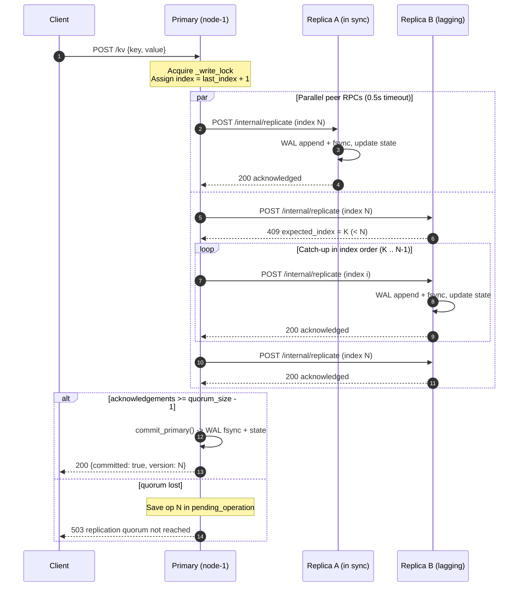

# Distributed Key-Value Store

A 3-node primary-replica key-value store written in Python (`Flask`, `Werkzeug`, and standard-library `urllib.request`, `zlib`, `threading`, and `concurrent.futures`).

I built this to implement quorum writes, replica catch-up, WAL crash recovery, and read-consistency modes directly instead of wrapping an existing consensus library.

## Quickstart

### Option 1: Docker Compose

```bash
docker compose up --build
```

This starts `node-1` (primary on `:5001`), `node-2` (replica on `:5002`), and `node-3` (replica on `:5003`) with persistent Docker volumes for each WAL file.

### Option 2: Local script

```bash
pip install -r requirements.txt
chmod +x run_cluster.sh
./run_cluster.sh
```

Or launch each node manually in separate terminals:

```bash
python node.py --node-id node-1 --role primary --port 5001 --peers http://127.0.0.1:5002,http://127.0.0.1:5003 --quorum-size 2 --wal-path data/primary.wal
python node.py --node-id node-2 --role replica --port 5002 --primary-url http://127.0.0.1:5001 --wal-path data/replica-a.wal
python node.py --node-id node-3 --role replica --port 5003 --primary-url http://127.0.0.1:5001 --wal-path data/replica-b.wal
```

Basic smoke check once the cluster is up:

```bash
curl -s -X POST http://127.0.0.1:5001/kv -H "Content-Type: application/json" -d '{"key":"service","value":"auth"}'
curl -s http://127.0.0.1:5002/kv/service
curl -s "http://127.0.0.1:5002/kv/service?consistency=local"
curl -s -X DELETE http://127.0.0.1:5001/kv/service
```

## HTTP Interface & Read Paths

| Method & Path | Target | Behavior |
|---|---|---|
| `POST /kv` | Primary (`409` on replica) | Writes `{key, value}`, replicates to quorum, commits locally |
| `DELETE /kv/<key>` | Primary (`409` on replica) | Tombstones `key` through the same quorum log path |
| `GET /kv/<key>` | Primary | Reads local `StoreState` (`consistency: primary`) |
| `GET /kv/<key>` | Replica (default) | Forwards to primary (`forwarded_to_primary`), falls back locally if primary is down (`local_fallback_stale_possible`) |
| `GET /kv/<key>?consistency=local` | Replica | Reads replica memory directly (`local_explicit`) |
| `GET /health` | Any | Returns `node_id`, `role`, `last_index`, `key_count`, `has_pending_operation`, `stats` |

Internal replication endpoints: `POST /internal/replicate`, `GET /internal/log?from_index=<n>`, and `GET /internal/state`.

## Replication & Crash Recovery



A few implementation details to keep in mind when reading `node.py` and `kvstore/`:

- `_write_lock` stays locked across peer RPCs so concurrent writes get strict log indices (`1, 2, 3...`), while `StoreState._lock` only wraps memory/WAL mutations and never spans network I/O. That keeps `GET /kv/<key>` non-blocking on the primary even when a replica stalls.
- Inside `_commit_with_quorum_locked`, the primary waits for `quorum_size - 1` replica acknowledgements before calling `commit_primary()`. If quorum fails, the uncommitted entry is parked in `pending_operation` (`503`) and must drain on the next write before any newer index is assigned.
- Replicas return `409` with `expected_index` on out-of-order entries (`_catch_up_peer` replays missing history in order) and pull `/internal/log?from_index=<next>` on startup.

When `--wal-path` is set, operations append as newline-delimited frames followed by `os.fsync()`:

```text
+------------+---+---------------------------------------------+----+
| crc32_hex  | | | canonical compact JSON (sorted keys, UTF-8) | 
 |
|  8 bytes   |1B |               variable length               | 1B |
+------------+---+---------------------------------------------+----+
```

On boot, `WriteAheadLog.replay()` (`kvstore/wal.py`) checks every frame: a torn tail at EOF is truncated back to the last valid offset and synced, whereas checksum corruption mid-log raises `ValueError` rather than dropping committed entries silently.

## Edge Cases & Assumptions

- **Single static primary:** There is no leader election; if the primary goes down, mutations wait until it restarts.
- **Partial-ack crash window when `quorum_size > 2`:** Because peers persist before the primary commits locally, a primary crash after fewer than `quorum_size - 1` acks leaves `pending_operation` uncommitted on the primary even though a subset of replicas wrote it. Recovering that safely requires Raft-style term tracking.
- **Uncompacted WAL:** Replaying large histories reads the full log sequentially; log snapshots/compaction are not implemented.
- **Sync-per-write cost:** `os.fsync()` on every frame bounds write throughput to disk latency.

## Tests & Files

```text
kvstore/wal.py        # CRC32 append-only WAL, EOF truncation, mid-log checks
kvstore/state.py      # StoreState lock, primary/replica apply, catch-up slices
kvstore/transport.py  # Stdlib HTTP JSON client for peer RPCs
node.py               # Flask routes, quorum broadcast, CLI flags
run_cluster.sh        # Starts and stops a local 3-node cluster
Dockerfile            # Container image for node.py
docker-compose.yml    # 3-node cluster with per-node WAL volumes
test_node.py          # 15 unit/WAL tests
simulation_test.py    # 3-process, 8-stage fault and catch-up simulation
```

```bash
python -m unittest discover -p "test_*.py" -v
python simulation_test.py
```

CI (`.github/workflows/ci.yml`) runs bytecode compilation, `test_node.py`, and `simulation_test.py` on Python `3.11` and `3.12`.
