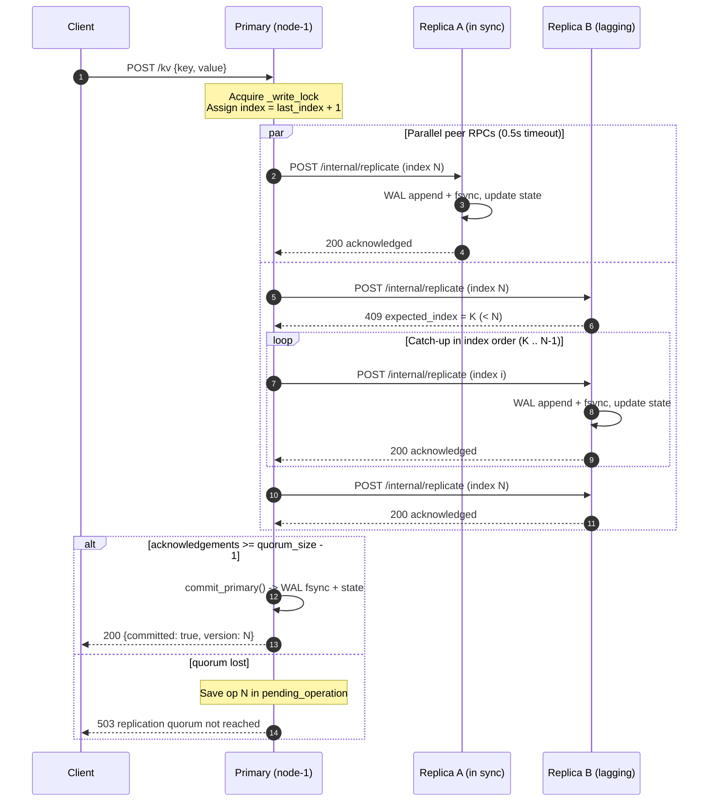

# Distributed Key-Value Store

A minimal 3-node primary-replica key-value store implemented in Python on top of `Flask`, `Werkzeug`, and the standard library (`urllib.request`, `zlib`, `threading`, `concurrent.futures`).

The project exists to work through the mechanics of quorum replication, out-of-order log catch-up, crash-safe write-ahead logging, and read-consistency modes from first principles, without delegating correctness to an external consensus engine or message broker.

---

## How Replication Works

Every mutation (`POST /kv` or `DELETE /kv/<key>`) enters through the primary. Replicas reject direct client writes with `409` and return the configured `primary` URL.



Two design details carry most of the correctness burden here:

1. **Lock isolation between writes and reads.** The primary holds `_write_lock` across peer RPCs so concurrent clients receive strictly monotonic log indices (`1, 2, 3, ...`) and write rounds never race each other. `StoreState._lock` (`kvstore/state.py`), however, only protects in-memory map updates and WAL appends, and is never held during network I/O. As a result, `GET /kv/<key>` on the primary stays non-blocking even when a replica is partitioned or timing out.
2. **Replication precedes primary commit.** Inside `_commit_with_quorum_locked`, the primary broadcasts index `N` to replicas first and commits locally (`commit_primary`) only after receiving `quorum_size - 1` acknowledgements (`1` replica ack for the default `2`-of-`3` quorum). Replicas persist the frame in `apply_replicated` before replying `200`, and reject out-of-order entries with `409` and `expected_index` so the primary can replay missing history in order (`_catch_up_peer`). New or restarted replicas also pull `/internal/log?from_index=<next_index>` before serving traffic.

If quorum cannot be reached, the primary holds operation `N` in `pending_operation` and returns `503`. The next write attempt must successfully drain `pending_operation` before a new index is assigned, preventing silent holes in the log.

---

## Read Consistency

`GET /kv/<key>` supports three observable consistency paths depending on which node receives the request and whether `?consistency=local` is passed:

| Target | Query Flag | Behavior | `consistency` field in response |
|---|---|---|---|
| Primary | — | Reads local `StoreState` directly under short state lock | `primary` |
| Replica | default (`primary`) | Forwards read to `primary_url/kv/<key>` | `forwarded_to_primary` |
| Replica | default (primary unreachable) | Falls back to local `StoreState` instead of failing closed | `local_fallback_stale_possible` |
| Replica | `?consistency=local` | Skips forwarding and reads replica state directly | `local_explicit` |

---

## Write-Ahead Log & Crash Recovery

When `--wal-path` is configured, every committed operation on the primary and every replicated operation on a replica is persisted as a single newline-delimited frame before returning:

```text
+------------+---+---------------------------------------------+----+
| crc32_hex  | | | canonical compact JSON (sorted keys, UTF-8) | \n |
|  8 bytes   |1B |               variable length               | 1B |
+------------+---+---------------------------------------------+----+
```

Each `append()` flushes the buffer and calls `os.fsync()`. On startup, `WriteAheadLog.replay()` (`kvstore/wal.py`) walks the file sequentially and validates each CRC32 checksum:

- **Torn tail at EOF** (an incomplete line or checksum mismatch on the final chunk left by an unclean process kill): truncated back to the last valid byte offset and synced before rebuilding memory.
- **Corruption mid-log** (a bad frame followed by valid newline-terminated records): raises `ValueError` on boot rather than silently dropping committed history.

Calling `os.fsync()` on every frame deliberately favors per-write durability over throughput; under heavy write load, throughput is bounded by disk sync latency rather than Python/HTTP overhead.

---

## HTTP Interface

| Method | Endpoint | Valid On | Purpose & Status Codes |
|---|---|---|---|
| `POST` | `/kv` | Primary | Write/overwrite `{"key": str, "value": any}` (`200`, `400`, `409` on replica, `503` quorum lost) |
| `DELETE` | `/kv/<key>` | Primary | Replicate tombstone delete (`200`, `409` on replica, `503` quorum lost) |
| `GET` | `/kv/<key>` | Primary, Replica | Read key according to consistency mode (`200`, `404`) |
| `GET` | `/health` | Primary, Replica | Node metadata (`role`, `last_index`, `key_count`, `has_pending_operation`, `stats`) |
| `POST` | `/internal/replicate` | Replica | Idempotent replication receiver (`200` applied/duplicate, `409` gap or conflict) |
| `GET` | `/internal/log` | Primary, Replica | Incremental log slice (`?from_index=1`) used during replica boot sync |
| `GET` | `/internal/state` | Primary, Replica | Full state dump (`store`, `last_index`, `stats`) for debugging and test assertions |

Example write response from the primary (`200 OK`):

```json
{
  "committed": true,
  "op": "put",
  "key": "service:auth",
  "value": {"status": "ok"},
  "version": 1,
  "acknowledgements": 2,
  "required_replica_acks": 1,
  "peer_results": [
    {"peer": "http://127.0.0.1:5002", "acknowledged": true, "status": 200, "detail": "operation applied"},
    {"peer": "http://127.0.0.1:5003", "acknowledged": true, "status": 200, "detail": "operation applied"}
  ],
  "consistency": "primary_write_quorum"
}
```

---

## Running a 3-Node Cluster

Install dependencies (`Flask` and `Werkzeug`):

```bash
pip install -r requirements.txt
```

Start the cluster across three terminals (each node runs a blocking threaded Werkzeug server; parent directories for `--wal-path` are created automatically):

```bash
# Terminal 1 — Primary (port 5001)
python node.py --node-id node-1 --role primary --port 5001 \
  --peers http://127.0.0.1:5002,http://127.0.0.1:5003 --wal-path data/node1.wal

# Terminal 2 — Replica A (port 5002)
python node.py --node-id node-2 --role replica --port 5002 \
  --primary-url http://127.0.0.1:5001 --wal-path data/node2.wal

# Terminal 3 — Replica B (port 5003)
python node.py --node-id node-3 --role replica --port 5003 \
  --primary-url http://127.0.0.1:5001 --wal-path data/node3.wal
```

Basic read/write check:

```bash
curl -s -X POST http://127.0.0.1:5001/kv \
  -H "Content-Type: application/json" \
  -d '{"key": "service:auth", "value": {"status": "ok"}}'

curl -s http://127.0.0.1:5002/kv/service:auth
curl -s "http://127.0.0.1:5002/kv/service:auth?consistency=local"
curl -s -X DELETE http://127.0.0.1:5001/kv/service:auth
```

### CLI Options (`node.py`)

| Flag | Default | Notes |
|---|---|---|
| `--node-id` | required | Identifier echoed in logs and status payloads |
| `--role` | required | `primary` or `replica` |
| `--host` | `127.0.0.1` | Bind address |
| `--port` | required | Listening port (`1..65535`) |
| `--peers` | `""` | Comma-separated replica URLs (required on primary) |
| `--primary-url` | `""` | Primary URL for boot sync and read forwarding (required on replica) |
| `--quorum-size` | `2` | Total acknowledgements required including primary (`1..cluster_size`) |
| `--timeout` | `0.5` | Per-RPC HTTP timeout in seconds |
| `--wal-path` | `""` | Path to WAL file; omit for pure in-memory execution |

---

## Repository Layout

```text
kvstore/
  wal.py            # CRC32-framed append-only log and torn-tail truncation
  state.py          # Thread-safe in-memory store, operation log, and metrics counters
  transport.py      # Minimal urllib HTTP/JSON wrapper with explicit timeouts
node.py             # Flask server, CLI entrypoint, quorum broadcast, and catch-up loop
test_node.py        # 10 unit/API tests covering WAL crashes, lock isolation, and conflicts
simulation_test.py  # 8-stage live 3-process cluster fault and restart simulation
```

---

## Testing & Failure Simulation

Run the unit test suite (`test_node.py`):

```bash
python -m unittest discover -p "test_*.py" -v
```

The 10 tests isolate WAL torn-tail truncation, payload validation, replica write rejection, non-blocking primary reads while a peer is artificially stalled, quorum loss/recovery, automatic catch-up after gaps, and duplicate vs. conflicting index handling.

Run the live multi-process simulation (`simulation_test.py`):

```bash
python simulation_test.py
```

This spawns three separate OS processes on ports `5001..5003` and walks through an 8-stage fault sequence:
1. Boot primary (WAL enabled) and two replicas.
2. Execute 30 concurrent writes (`12` worker threads).
3. Terminate Replica A and complete 20 writes under a `2`-of-`3` quorum.
4. Restart Replica A, verify automatic catch-up over the gap, and replicate a `DELETE`.
5. Restart the primary from its WAL and verify `last_index` continuity on new writes.
6. Kill both replicas to drop below quorum, confirm `503` rejection, bring one replica back, and verify the parked `pending_operation` recovers before the next write commits.
7. Verify forwarded reads across all keys, then kill the primary and verify `local_fallback_stale_possible`.

`.github/workflows/ci.yml` executes `py_compile`, `unittest`, and `simulation_test.py` on every push and pull request across Python `3.11` and `3.12`.

---

## Known Limitations & Edge Cases

- **Static primary without leader election.** There is no Raft/Paxos term or failover protocol. Writes block until the configured primary comes back online.
- **Head-of-line blocking on `pending_operation`.** When quorum drops, the unacknowledged operation remains in `pending_operation` and blocks subsequent writes (`503`) until quorum is restored so indices cannot fork.
- **Partial-ack divergence on primary crash when `quorum_size > 2`.** Because `pending_operation` lives only in primary memory until quorum succeeds, if one replica acknowledges operation `N` before quorum fails (`quorum_size = 3`) and the primary crashes before retrying, the primary reboots from its WAL at `N - 1` while that replica is already at `N`. A subsequent primary write for a different key at index `N` will be rejected by that replica as a `409` index conflict until an operator reconciles the divergent frame.
- **Unbounded log growth.** Neither `applied_operations` in memory nor the WAL file performs snapshotting or compaction.
